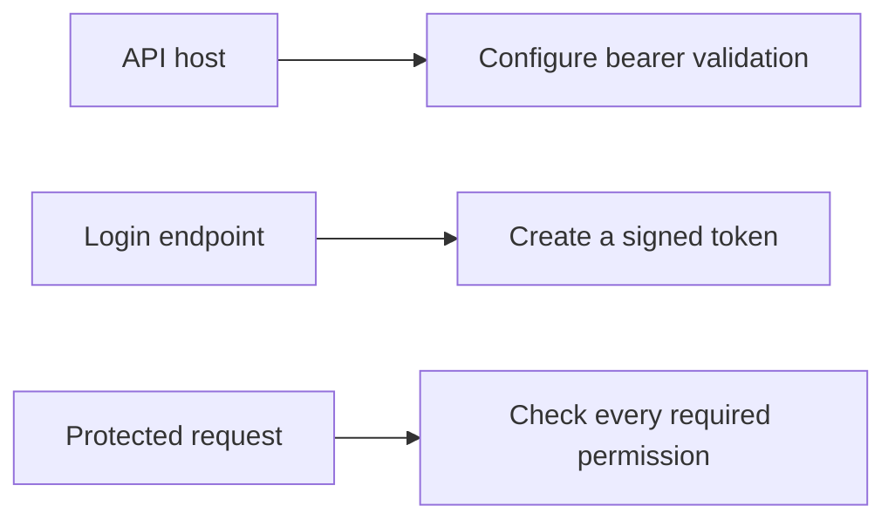
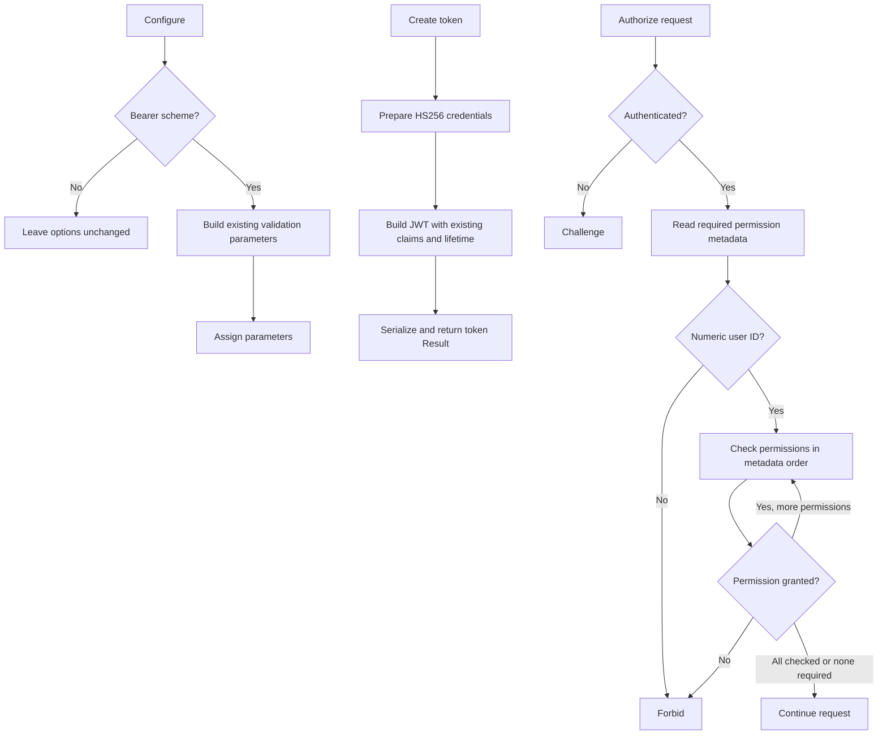

# Authentication workflows

The existing public types, filenames and framework entry points remain unchanged.
JWT configuration lives under `Auth/Configure/`, token creation under
`Auth/CreateToken/`, and permission evaluation under `Auth/Authorize/`. Supporting
tasks live in each operation's `Tasks/` folder. `PermissionAttribute.cs` retains
the metadata attribute at its existing shared owner.

Each workflow receives a separate Result for each meaningful task, logs safe
outcomes, and owns the stop/continue decision. Authentication and permission
exceptions are logged and rethrown; cancellation propagates. No additional input
validation, permissions, response bodies, token claims, algorithms, lifetimes or
clock skew settings are introduced. Logs never contain token text, claims,
credentials or signing keys. Expected authorization failures keep the existing
challenge/forbid responses.

Token service methods now return `Result<string>` so failed task Results propagate
to the login controller, which maps failure to its server-error response. Framework
authorization filters likewise map failed Results to failure responses instead of
throwing them. Bearer validation parameters remain a simple projection with no
manufactured Result failure; unexpected configuration errors still propagate.
