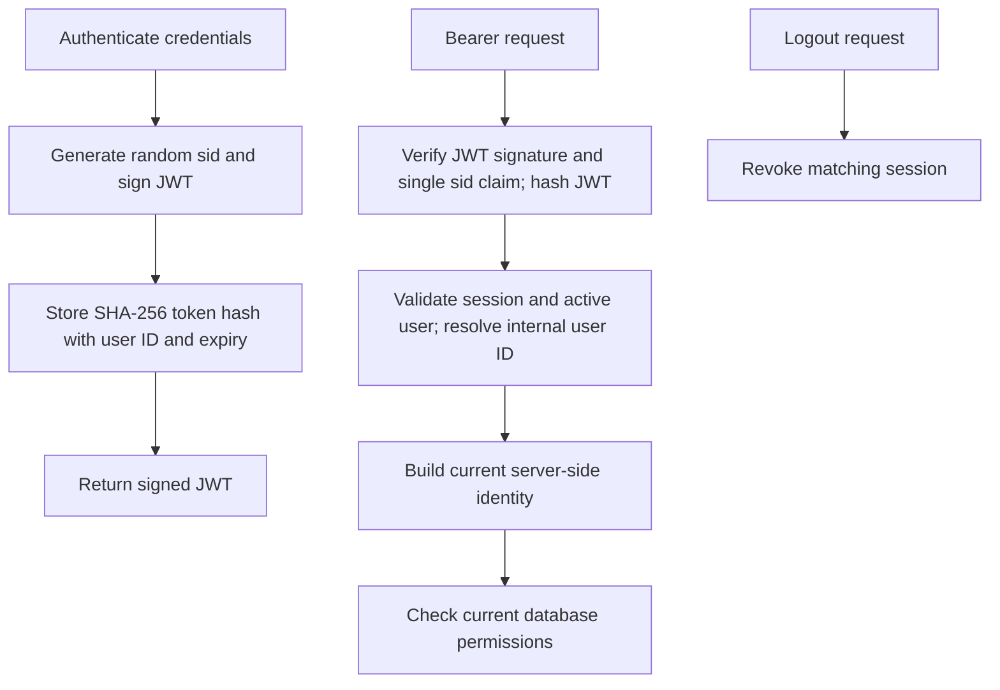

# Authentication workflows

The API uses signed JWT access tokens with one random `sid` claim. Domain owns session workflows under
`Features/Auth/Sessions/`, with persistence and token tasks in `Tasks/`.
Database owns the `AccessSession` entity and EF mappings. API authentication lives
under `Auth/Authenticate/`; endpoint permission enforcement remains under
`Auth/Authorize/`. Domain permission decisions use
`Features/Auth/CheckPermissions/`, with matching tasks in `Tasks/`.

Raw tokens contain no user IDs, names, roles, or permissions. Session records
contain only the token hash, internal user reference, expiration, and revocation
state. Identity and permission changes apply to subsequent requests. Login
responses contain only `accessToken`; user IDs, names, roles, and permission
lists are excluded. MVC creates an authenticated cookie ticket without profile or
permission claims, uses an independent random session nonce for antiforgery binding,
stores the JWT in its protected authentication
properties, and loads `/me` once per protected MVC page request. Current details
and permissions stay in scoped server memory and are not added to cookie claims.

Workflows inspect task Results and own stop/continue decisions. Authentication
and permission exceptions are logged and rethrown, while cancellation propagates.
Logs never contain raw tokens, token hashes, credentials, or user profile values.

SQLite startup creates the database and session table automatically through
Domain `DatabaseSetup`. The default file is `DevTrack.Api/devtrack.db`; its users
and sessions persist across restarts. Tests can use isolated InMemory databases.
Configure positive `AccessToken:ExpiresMinutes` (default 480).
Startup loads `AccessToken:SigningKey` or creates/reuses the local `devtrack.key`
file. Previous opaque tokens and JWTs with other claims require a fresh login.
API logout revokes the current session; MVC logout revokes it before clearing its
cookie. Invalid, expired, revoked, or disabled-user sessions receive HTTP 401;
valid sessions without required permissions receive HTTP 403.

`POST /api/auth/permission-check` accepts required permission names and returns only
`isAllowed`. It never returns the user's grants; the previous GET permission-list
endpoint has been removed. An empty requirement list still validates the session.
The API database never stores raw tokens. MVC must retain the bearer credential
for API calls, so it lives inside the encrypted authentication cookie; that cookie
contains no user profile or permission data.

Session validation selects only the internal user ID needed for authorization;
it does not load user profiles, password hashes, or roles. Pure principal-building
and successful persistence tasks use direct return values. Results represent
expected failures at workflow boundaries, rather than hypothetical task failures.

The JWT payload contains exactly `{ "sid": "<Base64URL random value>" }`, generated
from 32 secure random bytes. Signature verification requires HS256 and `typ=JWT`.
Expiry, issuer/audience isolation, and user access are enforced by the exact-token
hash lookup in this API's session store. This server-backed JWT intentionally has
no `exp`, `iss`, or `aud` claims and cannot be validated using its signature alone.
Keep the signing key separate from token hashes and persist it across restarts.

`GET /me` requires a valid active session. It uses the server-resolved internal
user ID to select current profile fields and current role grants from the database.
Only user ID, username, display name, role name, and permission names are returned.
No password hash, token hash, raw token, or signing key is returned. The JWT still
contains only `sid`, and login still returns only `accessToken`. Profile and grant
changes are reflected without issuing a new token. Responses use `Cache-Control: no-store`.
