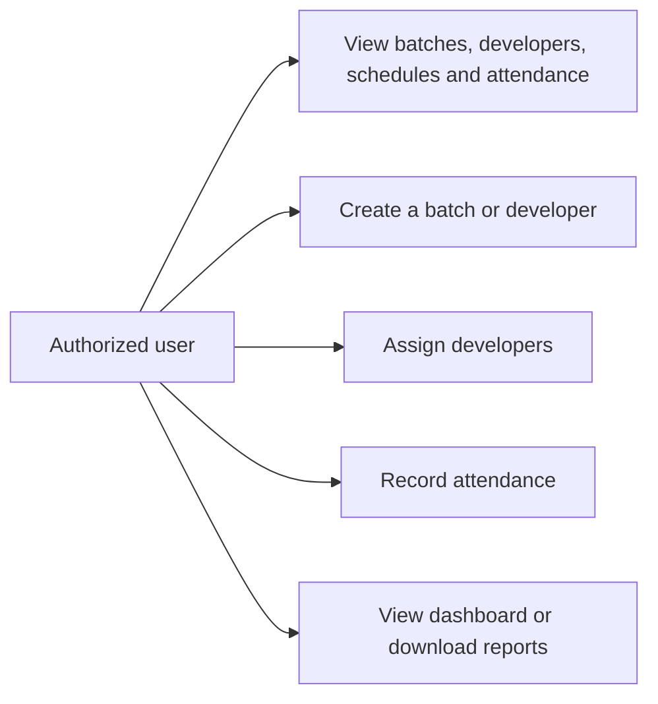
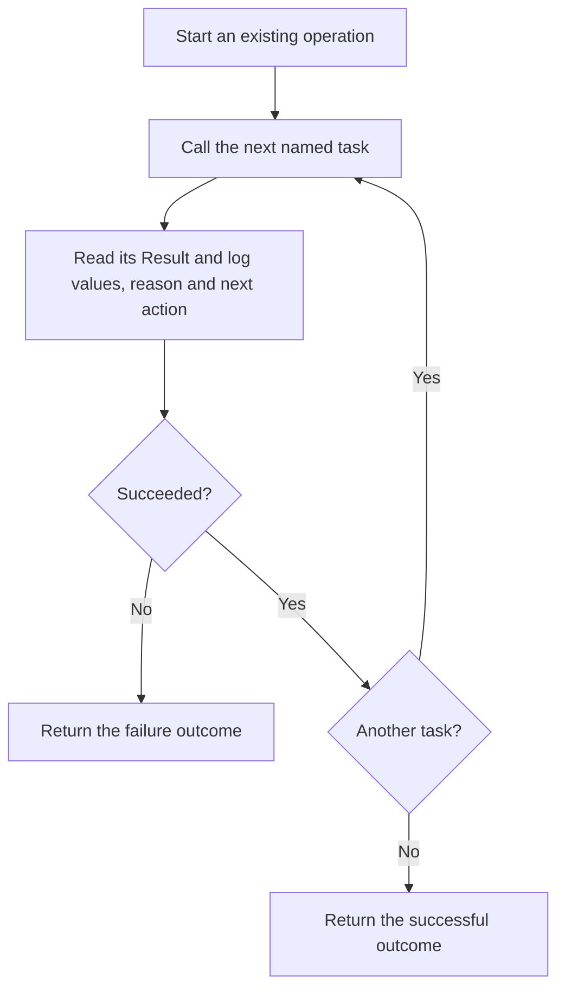
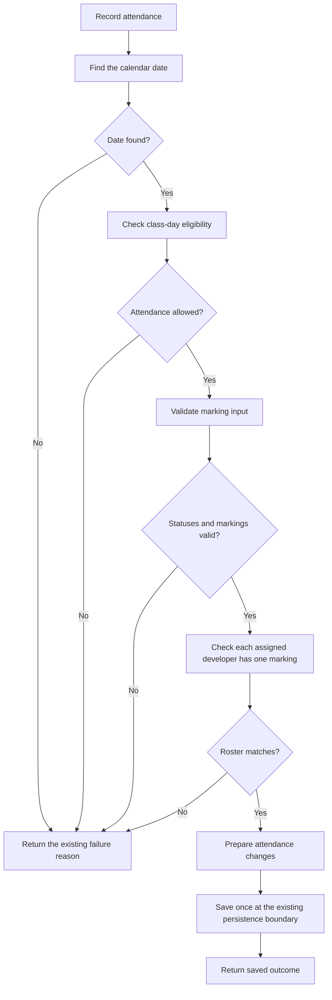

# Feature workflows

Each workflow file contains one existing public operation. Its service keeps its
public identity, interfaces, routes, permissions and response contracts. Service
construction and dependencies stay in the service declaration file.

Each operation has an action folder, such as `Create/` or `Details/`.
Keep all existing filenames when organizing folders. The workflow stays directly
inside the action folder. All supporting files go in `Tasks/` with their
original filenames, even when there is only one task file.

```text
Batches/
    BatchService.cs
    Create/
        BatchesCreateWorkflow.cs
        Tasks/
            BatchesCreateValidation.cs
            BatchesCreatePreparation.cs
            BatchesCreatePersistence.cs
    Details/
        BatchesDetailsWorkflow.cs
        Tasks/
            BatchesDetailsTask.cs
```

The same action-folder layout applies to all sixteen operations in Batches,
Developers, Dashboard and Training. Existing filenames, namespaces, partial
service classes and shared helper ownership remain unchanged.





Attendance recording preserves its existing failure precedence. Calendar lookup
and the class-day eligibility gate run before marking validation; valid markings
are required before checking the roster or preparing any writes. Each gate is a
separate task, and no task invokes the next stage.



Paged and downloadable attendance summaries reuse the same attendance criteria,
projection type and metric calculation. Those shared helpers retain their summary
owner instead of being copied into the report tasks. Unexpected failures keep the
existing service-boundary handling, and cancellation propagates.
