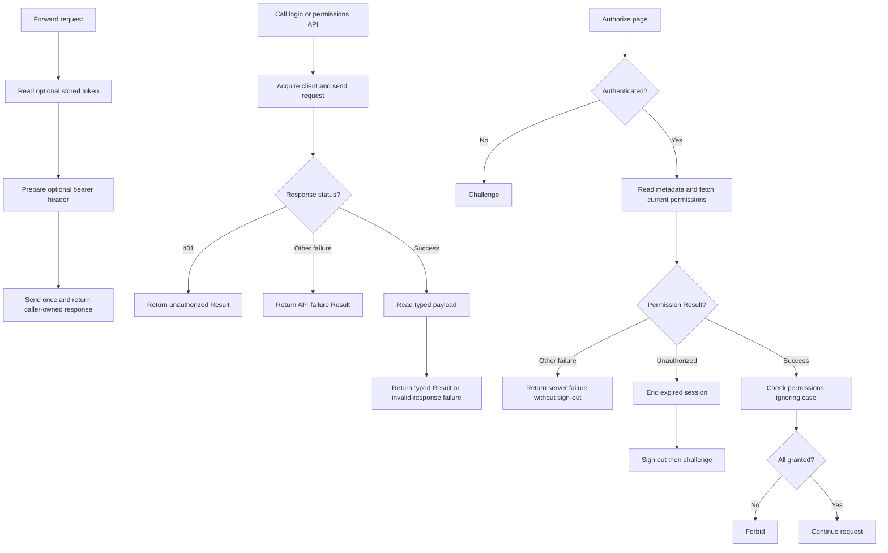

# Web authentication workflows

Existing filenames, namespaces and framework entry points are retained. Auth API
methods now return typed Results, and application callers inspect those outcomes.
Forwarding
lives in `Auth/ForwardToken/`, login in `Auth/Login/`, permission reads in
`Auth/GetPermissions/` and UI authorization in `Auth/Authorize/`. Every supporting
task lives in `Tasks/`. Shared HTTP tasks remain with `AuthApiClient` under
`Auth/Tasks/`; the original client declaration and permission metadata remain at
their existing owners.

Missing tokens leave existing headers unchanged. Authenticated pages still fetch
permissions even without permission metadata. API errors must not become empty
permissions or ordinary denials. Client and response scopes survive payload
reading and dispose on all exits; forwarded responses stay owned by the caller.
Cancellation propagates, the default sign-out scheme stays unchanged, and logs
exclude token text, passwords, claims and response bodies.

Failed Results propagate without being thrown. Optional error codes distinguish
unauthorized sessions from API failures and invalid payloads. Only unauthorized
sessions trigger sign-out. Other permission lookup failures become server error
responses; login failures return to the form with the safe failure reason.
Unexpected transport/authentication exceptions still log and propagate. Existing
Result JSON payloads omit the optional error code unless one is supplied.
