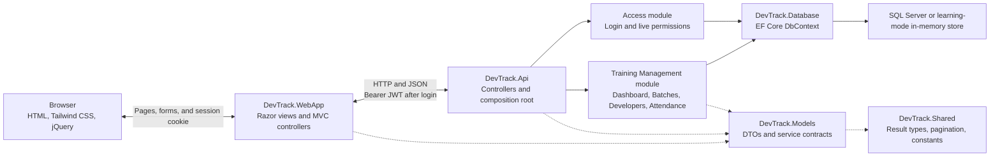
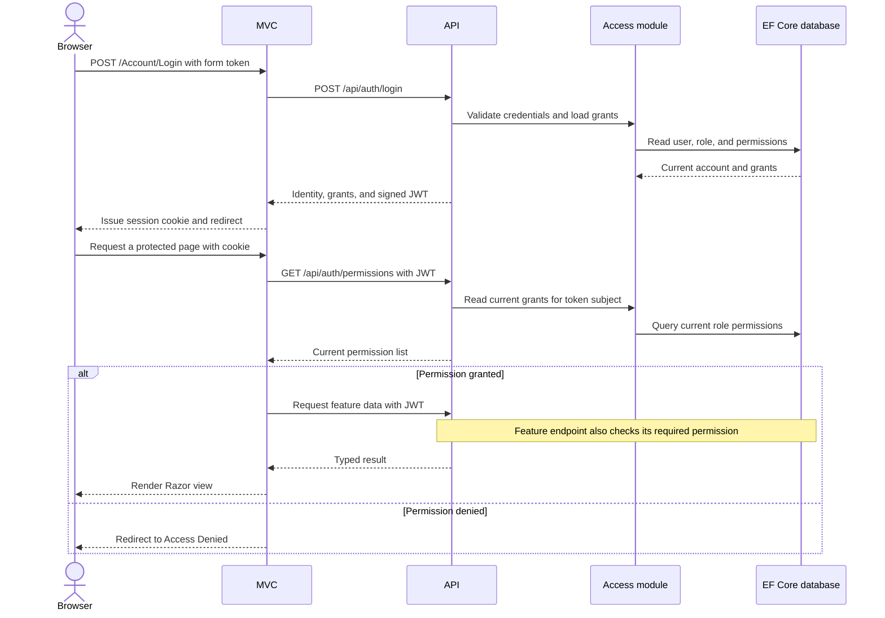
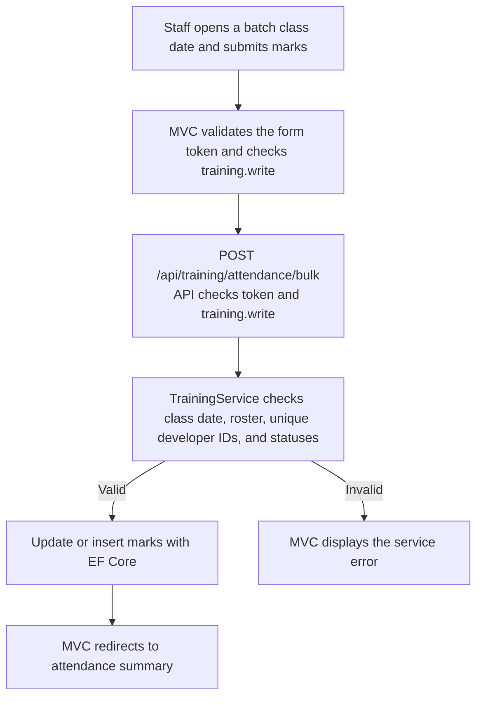

# DevTrack system flow

DevTrack runs an ASP.NET Core MVC frontend and an API backend. Razor renders HTML, Tailwind CSS styles the pages, and jQuery supports client-side scripts and validation. The shared mobile menu uses native JavaScript. The API owns authentication, authorization, training business rules, and persistence. Both apps use contracts from Models and result types from Shared.

## Architecture

In the combined container, the browser reaches MVC on port 8080 by default. MVC calls the API on container loopback port 5000. Render uses SQL Server. In-memory mode seeds sample training data and resets it when the API stops.

## Sign in and open a protected page

Invalid credentials return the login form with an error. If the API rejects the JWT on a permission check, MVC clears the cookie and challenges the browser to sign in again.

## Record attendance

The summary and CSV use the same attendance calculation. Eligibility uses the batch minimum, with 80% as the fallback when none is configured.

## Source entry points

| Area | Source |
| --- | --- |
| Container startup and ports | [Dockerfile](../Dockerfile) |
| API registration and initialization | [API Program](../DevTrack.Api/Program.cs) |
| MVC routing and antiforgery | [MVC Program](../DevTrack.WebApp/Program.cs) |
| Login and live grants | [API AuthController](../DevTrack.Api/Controllers/AuthController.cs), [MVC AccountController](../DevTrack.WebApp/Controllers/AccountController.cs), [RBAC service](../DevTrack.Domain.Access/Features/Auth/RbacService.cs) |
| Attendance validation and summary | [TrainingService](../DevTrack.Domain/Features/Training/TrainingService.cs), [AttendanceMetrics](../DevTrack.Domain/Features/Training/AttendanceMetrics.cs) |
| Database mappings | [DevTrackDbContext](../DevTrack.Database/Entities/DevTrackDbContext.cs) |

The [interactive graph](graph.html) provides the file and symbol relationships behind this overview. The [extraction report](GRAPH_REPORT.md) records how the graph was built.
